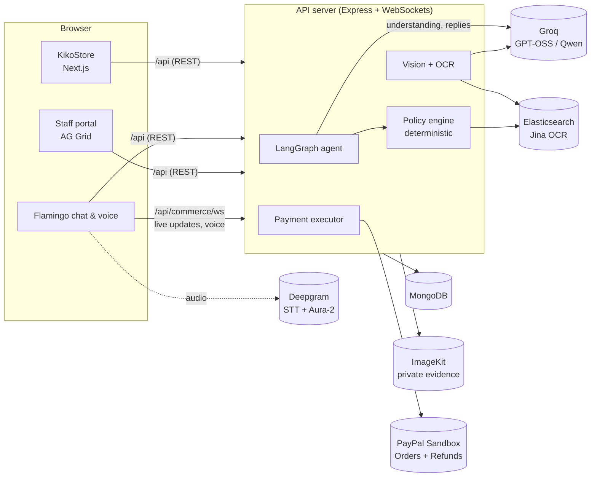

# Flamingo AI

### Customer support that resolves, not just responds.

Flamingo AI is an AI resolution agent for online stores. It owns a return or refund from the customer's first message to the money moving back through PayPal. It verifies the order, understands the problem by text or live voice, inspects photo evidence, applies the store's policy and approves the outcome itself. It hands a case to staff only when the store's rules require a person.

Built for the **PayPal AI Hackathon** with open-weight models only.

| | |
|---|---|
| **Live demo** | https://flamingooai.replit.app/kikostore |
| **Demo video** | _add your YouTube link here_ |
| **Devpost** | _add your Devpost link here_ |

> Everything runs in **PayPal Sandbox** with test money. There is no live-money mode.

---

## Contents

1. [What it does](#what-it-does)
2. [How a case flows](#how-a-case-flows)
3. [Architecture](#architecture)
4. [Tech stack](#tech-stack)
5. [Safety design: the model talks, the code decides](#safety-design-the-model-talks-the-code-decides)
6. [Repository layout](#repository-layout)
7. [Setup](#setup)
   - [Prerequisites](#1-prerequisites)
   - [Create your service accounts](#2-create-your-service-accounts)
   - [Configure environment variables](#3-configure-environment-variables)
   - [Run locally](#4-run-locally)
   - [Run and publish on Replit](#5-run-and-publish-on-replit)
8. [Demo walkthrough](#demo-walkthrough)
9. [Testing](#testing)
10. [Environment variable reference](#environment-variable-reference)
11. [Troubleshooting](#troubleshooting)
12. [Limitations and what's next](#limitations-and-whats-next)

---

## What it does

The project contains three connected parts:

| Part | URL | Who uses it |
|---|---|---|
| **KikoStore** | `/kikostore` | A demo shop. Customers buy with PayPal Sandbox and see their orders. |
| **Flamingo support** | `/flamingo-support` | The AI agent. Customers chat or call about an order. |
| **Staff portal** | `/flamingo-portal` | Store staff: live case queue, decisions, policy and AI costs. |

**For customers**

- **Order-aware from the first message.** The product, price, delivery and payment are already loaded, so the customer never repeats them.
- **Text or live voice.** Real-time speech-to-text and natural spoken replies (Deepgram). Customers can upload photos during a call without hanging up.
- **Any language.** Customers can write or speak in Hindi (including Hinglish typed in English letters), Spanish, French and dozens of other languages. Flamingo replies in the same language. Every decision is still made in English by the store's rules; a translated reply is used only if every amount, code and button name in it is unchanged.
- **Handles anything a customer types.** Greetings, small talk, product how-to questions, requests for another order, off-topic questions, insults and gibberish get a short, polite answer and are steered back to the order. None of these change the case or any payment.
- **Photo inspection.** An open-weight vision model checks that the photo shows the ordered product and describes visible damage. Text in images is read with OCR.
- **Decides within policy:**

| Situation | Outcome |
|---|---|
| Damaged or faulty, up to $50 | Instant refund, and the customer keeps the item |
| Other eligible requests, up to $100 | Return approved, refunded once the item is received |
| Over $100, final sale, past 30 days, parcel never arrived, or "I want a person" | Handed to staff with the full story |

- **The customer stays in control.** Nothing is paid until they tap **Confirm**, and eligibility is checked again at that moment.

**For staff**

- **Live queue** (AG Grid) showing only the cases that need a person, with the evidence, the AI's reasoning steps and the exact policy passages it relied on.
- **Decisions with a written reason:** approve a refund or return, decline, reply, reopen, confirm warehouse receipt or sync with PayPal. Every decision is recorded.
- **Policy editor:** return window, automatic limit and instant refund limit, with versioning.
- **Policy PDFs:** import a returns policy PDF, review the extracted text, save it as a draft, then publish. Flamingo searches it (Elastic) and quotes it. A document can only **tighten** the rules.
- **AI cost of every case:** tokens, voice seconds and estimated cost.

---

## How a case flows

```
Customer buys on KikoStore ──► PayPal Sandbox checkout ──► payment captured
                                                                 │
Customer: "my speaker has no sound, the cone is torn" ◄──────────┘
        │
        ▼
┌──────────────────────── LangGraph pipeline (every message) ────────────────────────┐
│ verify_order → retrieve_policy → understand_in_context → investigate               │
│      → evaluate_and_respond → compose_reply → verify_next_step                     │
└────────────────────────────────────────────────────────────────────────────────────┘
        │
        ├── needs evidence ─► asks once for a photo ─► vision check + OCR
        ├── within policy ──► proposes a refund or return ─► customer taps Confirm
        │                         └─► PayPal Sandbox refund ─► verified ─► case closed
        └── outside policy ─► handed to staff portal with the full case
```

---

## Architecture



- The **Next.js app** and the **API server** run as separate processes behind one origin. `/api/*` goes to the API server and everything else goes to Next.js. On Replit, the platform router does this. Locally, `pnpm run dev:local` starts both servers and a small proxy that does the same.
- Provider keys **never reach the browser**. Voice audio, photos and PayPal calls all go through the API server.
- Evidence photos are stored as **private** ImageKit files and served through short-lived signed URLs fetched by the server.

---

## Tech stack

| Layer | Technology |
|---|---|
| Agent orchestration | **LangGraph** (LangChain JS) |
| Language models | **Groq**: `openai/gpt-oss-20b` (understanding and reply translation), `openai/gpt-oss-120b` (language detection and message reading), Qwen (reply writer and vision) |
| Policy search and OCR | **Elasticsearch** hybrid/semantic search, Jina OCR |
| Voice | **Deepgram** streaming speech-to-text and Aura-2 text-to-speech |
| Payments | **PayPal REST API** (Orders v2 checkout and capture, Payments v2 refunds), Sandbox |
| Database | **MongoDB** (Atlas) |
| Evidence storage | **ImageKit** (private files, signed URLs) |
| Frontend | **Next.js 16**, React 19, Tailwind CSS, Radix UI, **AG Grid**, TanStack Query, pdf.js |
| Backend | Node.js 24, Express 5, `ws`, Zod, sharp, pino |
| API contract | OpenAPI spec, then Orval-generated React Query hooks and Zod schemas |
| Tooling | pnpm workspaces, TypeScript 5.9, esbuild, Replit |

---

## Safety design: the model talks, the code decides

An LLM should understand a frustrated customer. It should never decide how much money leaves the business. Flamingo enforces this in code, not in prompts:

- **Money decisions are deterministic.** The policy engine makes every approval. The model has no payment tools.
- **Model output is constrained.** Interpretations must be valid structured JSON, and any detail the model extracts must appear in what the customer actually said.
- **The AI writes only the conversational opener.** The amount, approval and next step are appended word for word by code. A streaming guard holds back text so the model can't promise money it wasn't given.
- **Hard caps on the server.** At most a 365-day window, $100 automatic and $50 instant, whatever an admin saves.
- **Uploaded policies can only tighten the rules.** A published PDF can add conditions or send cases to staff. It can never raise a limit. Its text is treated as evidence, never as instructions.
- **Stale approvals are cancelled.** Changing the policy cancels pending proposals, and every approval is re-checked when the customer confirms.
- **Refunds are a guarded state machine** (proposed → confirmed → submitted → completed). The refund intent is saved before PayPal is called, duplicate refunds are blocked, and an uncertain outcome is never retried automatically.
- **"Unknown" is not "no".** Only an explicit policy restriction blocks a customer. A missing answer or a technical failure falls back to the store's rules.

---

## Repository layout

```
.
├── artifacts/
│   ├── flamingo/              Next.js app: KikoStore, Flamingo support, staff portal
│   │   ├── src/app/           routes (/kikostore, /flamingo-support, /flamingo-portal, ...)
│   │   ├── src/components/commerce/   store, chat, call, evidence, portal, policy UI
│   │   ├── public/products/   product images
│   │   └── scripts/copy-pdf-worker.mjs   copies the pdf.js worker into public/
│   ├── api-server/            Express API + WebSockets
│   │   └── src/lib/commerce/
│   │       ├── agent.ts           LangGraph pipeline and policy decisions
│   │       ├── understanding.ts   intent and reason detection (incl. misheard speech)
│   │       ├── conversation.ts    turn handling, proposals, confirmations
│   │       ├── vision.ts          photo inspection (Groq vision)
│   │       ├── elastic-image.ts   OCR through Elastic
│   │       ├── policy-library.ts  policy rules, PDF documents, Elastic search
│   │       ├── payments.ts        PayPal checkout, capture, refund, verification
│   │       ├── live-voice.ts      Deepgram streaming
│   │       ├── reply-writer.ts    streamed replies with the safety guard
│   │       ├── image-store.ts     ImageKit private storage
│   │       └── *.test.ts          unit tests
│   └── mockup-sandbox/        design preview tool (not part of the product)
├── lib/
│   ├── api-spec/              OpenAPI spec and codegen config
│   ├── api-client-react/      generated React Query client
│   ├── api-zod/               generated Zod schemas
│   └── db/                    legacy Postgres schema (not used by Flamingo)
├── scripts/local-dev.mjs      one-command local runner (API + web + proxy)
├── docs/                      Devpost text, demo video script, KikoStore guide
├── .env.example               every environment variable, without values
└── pnpm-workspace.yaml
```

> The routes `/start` and `/app` contain an earlier receivables prototype kept for reference. The product described here is the KikoStore and Flamingo returns flow.

---

## Setup

### 1. Prerequisites

| Tool | Version | Check |
|---|---|---|
| Node.js | **24** or newer | `node -v` |
| pnpm | **10** or newer | `pnpm -v` (install with `npm install -g pnpm` or `corepack enable`) |
| Git | any | `git --version` |

### 2. Create your service accounts

All services below have free tiers. You need the **required** ones for the full demo. The optional ones turn on extra features.

#### MongoDB Atlas (required)
1. Create a free cluster at https://www.mongodb.com/cloud/atlas.
2. **Database Access:** add a database user with a password.
3. **Network Access:** allow your IP address (or `0.0.0.0/0` for a hosted deployment).
4. **Connect → Drivers:** copy the connection string into `MONGODB_URI`, with your password filled in.

#### PayPal Sandbox (required)
1. Sign in at https://developer.paypal.com.
2. **Apps & Credentials → Sandbox → Create App** (type: Merchant). Copy the **Client ID** and **Secret** into `PAYPAL_CLIENT_ID` and `PAYPAL_CLIENT_SECRET`.
3. **Testing Tools → Sandbox Accounts:** note the **Personal** (buyer) account's email and password. You use it on the PayPal checkout page.
4. To see payments and refunds from the buyer's side, sign in to https://sandbox.paypal.com with that buyer account.

#### Groq (required for AI understanding and photo checks)
1. Create a key at https://console.groq.com/keys and put it in `GROQ_API_KEY`.
2. Without it, Flamingo falls back to rules only: it still handles clear requests, but it can't interpret free-form text or photos.

#### ImageKit (required for photo uploads)
1. Sign up at https://imagekit.io.
2. **Developer options → API keys:** copy the **Private key** into `IMAGEKIT_PRIVATE_KEY` and the **URL endpoint** (for example `https://ik.imagekit.io/your_id`) into `IMAGEKIT_URL_ENDPOINT`.

#### Deepgram (optional: voice calls)
1. Create a key at https://console.deepgram.com and put it in `DEEPGRAM_API_KEY`.
2. Without it, the call button shows as unavailable and text chat works normally.

#### Elasticsearch (optional: semantic policy search and OCR)
1. Create a deployment on Elastic Cloud (https://cloud.elastic.co) or Elastic Serverless.
2. Copy the endpoint URL into `ELASTICSEARCH_URL` and create an API key for `ELASTICSEARCH_API_KEY`.
3. Set `ELASTICSEARCH_INFERENCE_ID` to the inference endpoint used for the `semantic_text` field, for example `.elser-2-elasticsearch`.
4. Without these, policy search uses local text retrieval, and the portal shows "Local text retrieval".

#### Session secret (required)
Generate a random value for `SESSION_SECRET`:
```bash
node -e "console.log(require('crypto').randomBytes(48).toString('hex'))"
```

### 3. Configure environment variables

```bash
git clone https://github.com/<your-username>/<your-repo>.git
cd <your-repo>
cp .env.example .env
```

Open `.env` and fill in the values from step 2. **Never commit `.env`.** It is already in `.gitignore`, and only `.env.example` (with no values) is tracked.

### 4. Run locally

```bash
pnpm install
pnpm run dev:local
```

`dev:local` loads `.env`, starts the API server (port 8080) and the Next.js app (port 3001), and puts a proxy in front of both on **port 3000**. Open:

- Store: http://localhost:3000/kikostore
- Support: http://localhost:3000/flamingo-support
- Staff portal: http://localhost:3000/flamingo-portal

> Always use port **3000**. The API rejects cross-origin writes and WebSockets, and PayPal return links are built from the address in your browser, so the app must be used through the single-origin proxy.

To change ports, set `LOCAL_PORT`, `API_PORT` or `WEB_PORT` in `.env`.

**Running the servers separately** (for example to debug one of them):
```bash
# terminal 1: API server (export the variables from .env first)
set -a; source .env; set +a
PORT=8080 pnpm --filter @workspace/api-server run dev

# terminal 2: web app
PORT=3001 pnpm --filter @workspace/flamingo run dev
```
You still need a proxy that sends `/api` to port 8080 and everything else to port 3001 on one origin. `scripts/local-dev.mjs` is the simplest way to get one.

**Production build:**
```bash
pnpm run typecheck
pnpm --filter @workspace/api-server run build
pnpm --filter @workspace/flamingo run build      # also copies the pdf.js worker into public/
PORT=8080 node artifacts/api-server/dist/index.mjs
PORT=3001 pnpm --filter @workspace/flamingo run serve
```
In production, put a reverse proxy (nginx, Caddy, a load balancer) in front with the same routing: `/api` and the `/api/commerce/ws` WebSocket to the API server, everything else to Next.js.

### 5. Run and publish on Replit

1. Import the GitHub repository into Replit.
2. Open **Secrets** and add each variable from `.env.example` with your values. Don't upload a `.env` file.
3. Click **Run**. The project already defines the two services (API server on `/api`, web app on `/`).
4. Click **Publish** to deploy. Secrets are copied to the deployment, and the router keeps both services on one domain.

---

## Demo walkthrough

1. **Buy something.** Open `/kikostore`, pick the **Pebble Mini Bluetooth Speaker ($39)** and choose **Pay with PayPal Sandbox → Continue to PayPal Sandbox**. Sign in with your Sandbox **buyer** account and pay.
2. **Capture.** Back on **My orders**, click **Confirm capture**. The banner shows "PayPal Sandbox payment captured". The payment also appears in the buyer's sandbox.paypal.com **Activity**.
   - Want to skip PayPal? **Place sample order** creates a delivered order instantly, but its refund is simulated.
3. **Ask for help.** Click **Get help** on the order. Type or click **Call Flamingo** and say something like "My speaker has no sound and the cone is torn."
4. **Send a photo.** When Flamingo asks, tap **Photos** and upload a picture of the damage, even during a call.
5. **Confirm.** Flamingo proposes a $39 refund and you keep the item. Tap **Confirm refund**. The case shows the PayPal refund reference, and the refund appears in the buyer's PayPal Activity.
6. **See a staff case.** Order the **Orbit Smart Watch ($149)** and ask for a refund. It's above the $100 limit, so it goes to staff.
7. **Staff portal.** Open `/flamingo-portal`:
   - **Live queue:** open the watch case to see the evidence, reasoning and policy quotes. Type a reason and approve or decline.
   - **Policy:** change the return window and click **Save rules**. Try an automatic limit of 500 to see that it's blocked. **Import PDF** to add a supplemental policy, then **Save as draft** and **Publish**.
   - **Costs:** the AI cost of each case.

Demo rules: 30-day return window, $100 automatic limit, $50 instant keep-the-item refund. The **Daily Insulated Bottle** is final sale.

> The demo uses a demo-controller session, and one browser can switch between customer and staff views. This is intentional for judging and is **not** production authentication.

---

## Testing

```bash
pnpm run typecheck                               # all packages
pnpm --filter @workspace/api-server run test     # 35 unit tests: policy, understanding, evidence, writer guard
```

End-to-end checks against the running app. These scripts target the Replit development URL (`REPLIT_DEV_DOMAIN`), so run them from the Replit shell. They use your configured services.
```bash
node artifacts/api-server/check-commerce-flow.mjs
node artifacts/api-server/check-commerce-flow.mjs --ai --voice --paypal-checkout   # real provider calls, no money captured
node artifacts/api-server/check-support-regression.mjs
```

After changing the API contract in `lib/api-spec`, regenerate the client:
```bash
pnpm --filter @workspace/api-spec run codegen
```

---

## Environment variable reference

| Variable | Required | Used for |
|---|---|---|
| `SESSION_SECRET` | Yes | Signs the demo session cookie |
| `MONGODB_URI` | Yes | Stores stores, orders, cases and policies |
| `GROQ_API_KEY` | Yes* | Understanding, reply writing and photo inspection (*rules-only without it) |
| `PAYPAL_CLIENT_ID` | Yes | PayPal Sandbox checkout and refunds |
| `PAYPAL_CLIENT_SECRET` | Yes | PayPal Sandbox checkout and refunds |
| `IMAGEKIT_PRIVATE_KEY` | Yes | Private evidence photo storage |
| `IMAGEKIT_URL_ENDPOINT` | Yes | Private evidence photo storage |
| `DEEPGRAM_API_KEY` | No | Voice calls (speech-to-text and Aura-2 voice) |
| `ELASTICSEARCH_URL` | No | Semantic policy search and OCR |
| `ELASTICSEARCH_API_KEY` | No | Semantic policy search and OCR |
| `ELASTICSEARCH_INFERENCE_ID` | No | Inference endpoint for semantic policy search |
| `GROQ_MODEL`, `GROQ_WRITER_MODEL`, `GROQ_VISION_MODEL`, `GROQ_LANGUAGE_MODEL`, `GROQ_TRANSLATION_MODEL` | No | Override the default models |
| `LOCAL_PORT`, `API_PORT`, `WEB_PORT` | No | Ports for `pnpm run dev:local` |
| `LOG_LEVEL` | No | API log level (default `info`) |

---

## Troubleshooting

| Problem | Cause and fix |
|---|---|
| **"Setting up fake worker failed … pdf.worker.min.mjs"** when importing a PDF | The pdf.js worker wasn't copied into `artifacts/flamingo/public/`. The `dev` and `build` scripts copy it automatically. Run `pnpm --filter @workspace/flamingo run build` again, and make sure your deploy doesn't exclude `public/pdf.worker.min.mjs`. |
| "Cross-origin writes are not allowed" (403) | You opened the Next.js port directly. Use the proxy on port 3000 (`pnpm run dev:local`). |
| Live updates or voice don't connect | Same cause: the WebSocket must go through the same origin. Also allow microphone access in the browser. |
| "MongoDB" not configured or can't connect | Check `MONGODB_URI` and Atlas **Network Access**. Flamingo never silently switches to local storage when MongoDB is configured. |
| "Confirm capture" fails | Make sure you clicked **Pay** on the PayPal page. Use **Open PayPal again** if needed. |
| A photo check is slow or says to wait | The Groq free tier allows about two photo checks a minute. Wait 30 to 60 seconds. |
| The portal shows "Local text retrieval" | Elasticsearch isn't configured. Policy search still works with local text. |
| "Policy not changed" | The policy changed in another tab. Click **Reset** and save again. |

---

## Limitations and what's next

**Current limitations (by design for the hackathon)**
- PayPal **Sandbox only**. There is no live-money switch.
- Demo-controller sessions instead of real customer and staff authentication.
- No real shipping, return labels or carrier tracking.
- Provider usage quotas are tracked in a single process. Production needs a shared quota store.
- Replies in other languages are not streamed word by word; they appear once translated. Staff messages are not translated.

**What's next**
- An SDK and Shopify and WooCommerce plugins that connect orders, payments and policies in minutes.
- Multi-store support with secure merchant sign-in.
- Live PayPal payments, plus the PayPal Disputes API to resolve problems before they become chargebacks.
- Fraud signals: reused or internet photos, refund frequency, mismatched products.
- Natural server-side voices for more languages. Today Deepgram speaks English, Spanish, French, German, Italian, Dutch and Japanese; other languages, including Hindi, use the browser's built-in voice.
- Merchant analytics: automation rate, time to resolution and cost per case.

---

## License

MIT. See [LICENSE](LICENSE).
